# TP1 - Modèle Entités-Associations

## Ex1 Q1 Livre

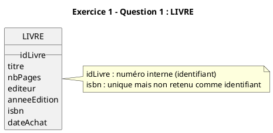

## Ex1 Q2 Professeur

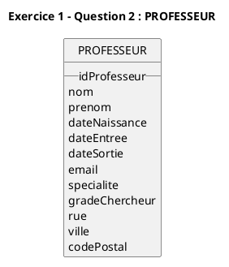

## Ex1 Q3 Etudiant

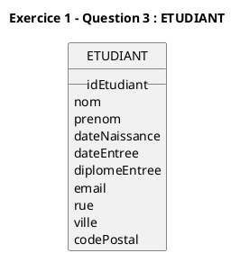

## Ex1 Q4 Promotion

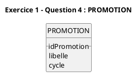

## Ex1 Q5 Matiere

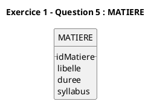

## Ex2 Q1 Matiere Promotion

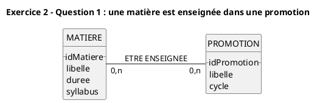

## Ex2 Q2 Professeur Matiere

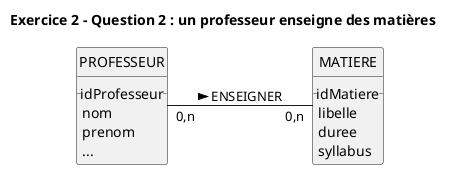

## Ex2 Q3 Livre Matiere

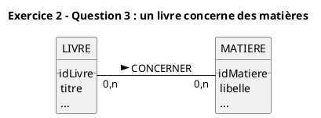

## Ex2 Q4 Livre MotCle

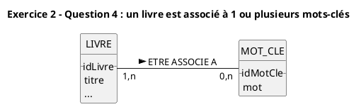

## Ex3 Q1 Prerequis

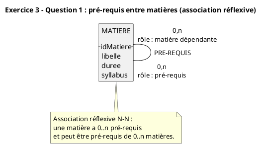

## Ex3 Q2 Statut Annee

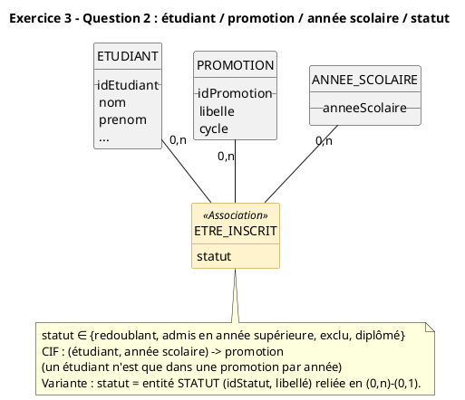

## Ex3 Q3 Cycle

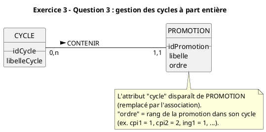

## Ex3 Q4 Evaluation

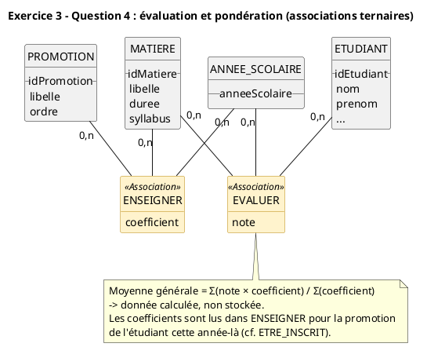

## MCD global

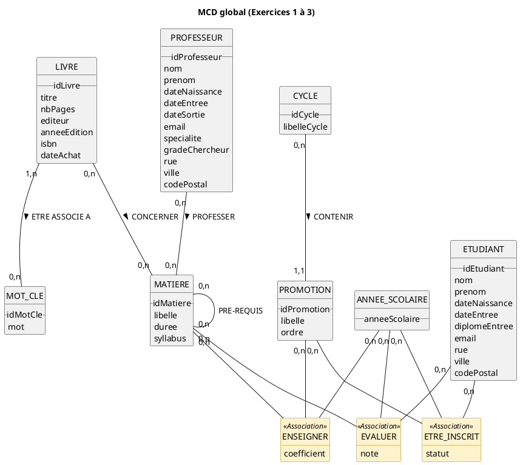

## Ex3 Q5 Relationnel

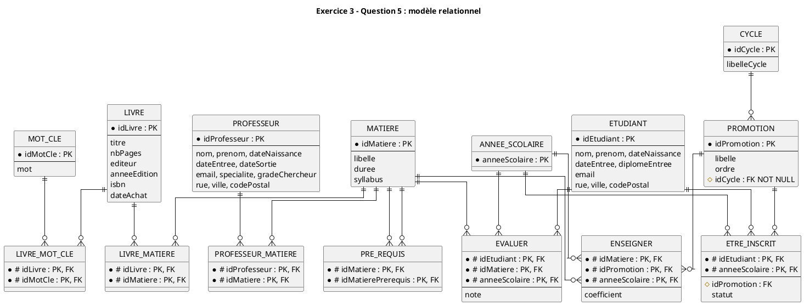

## Ex4 MCD enonce

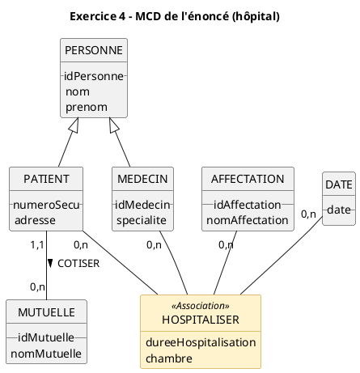

## Ex4 Relationnel

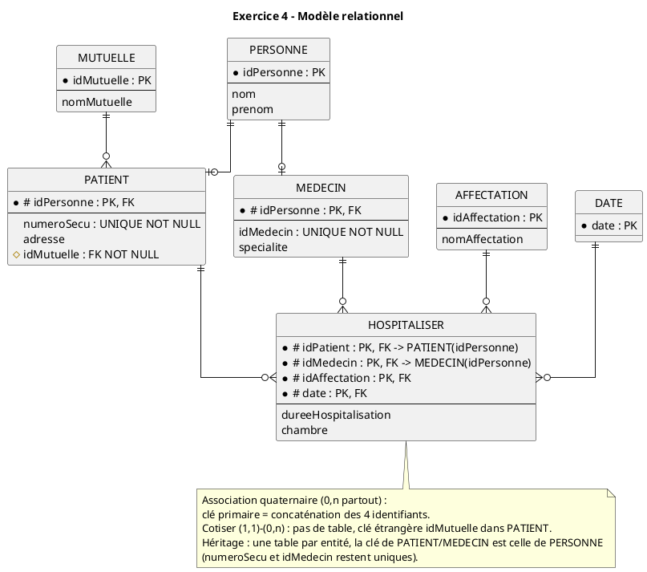
