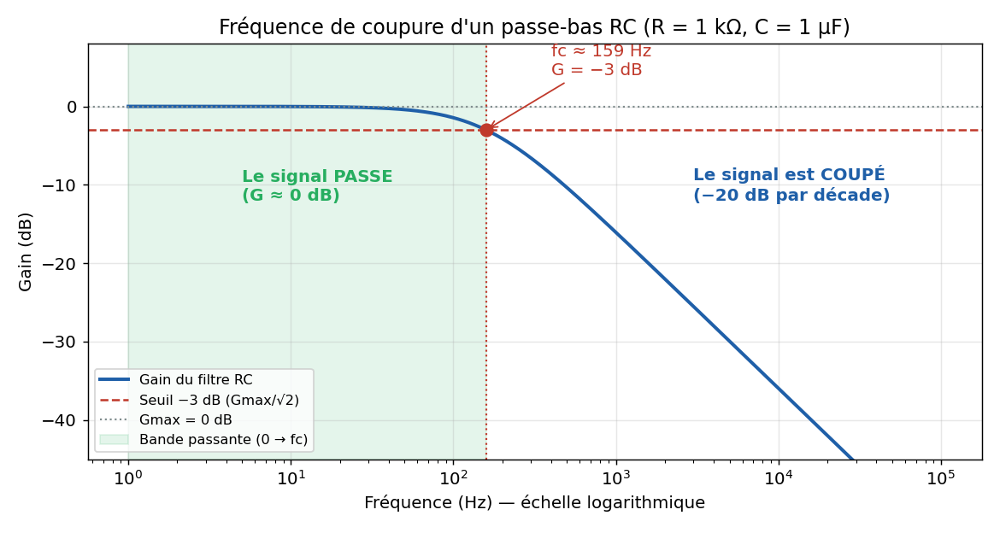
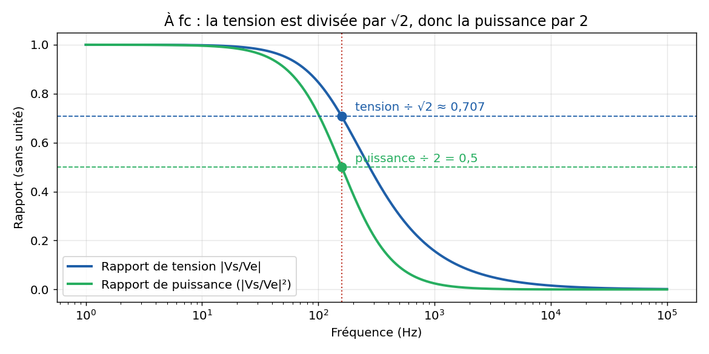
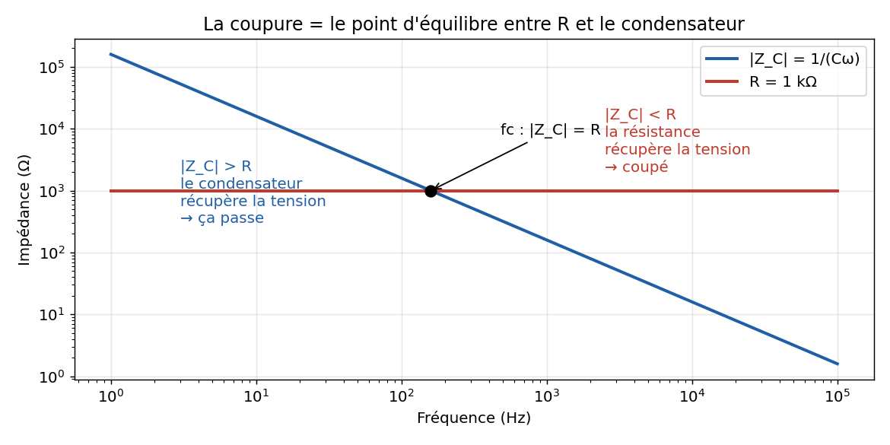
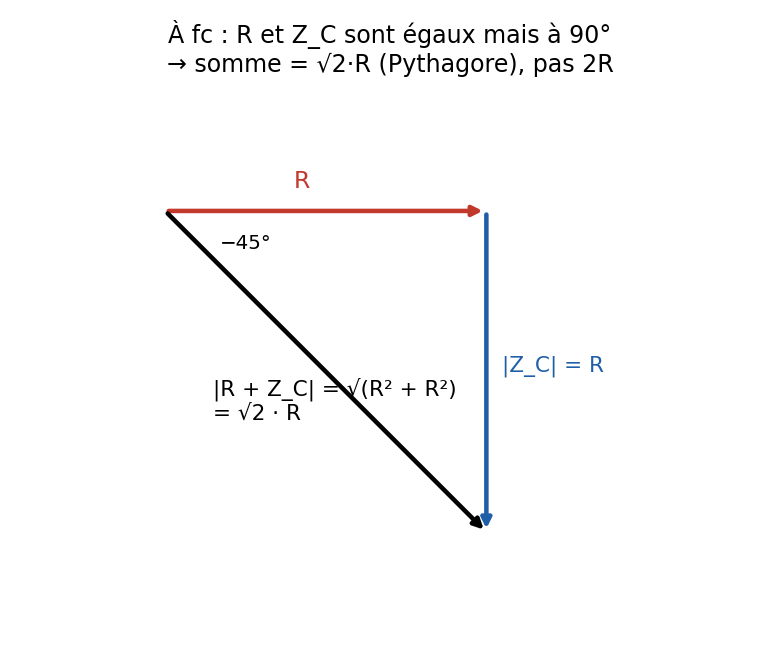
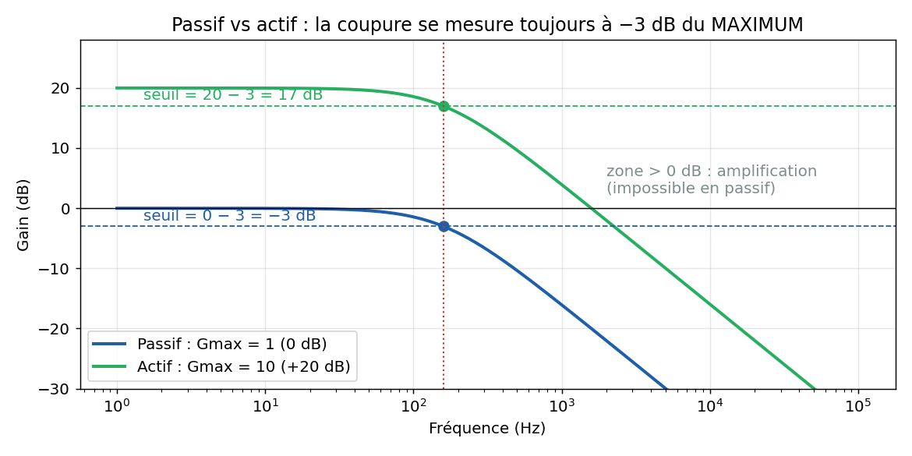
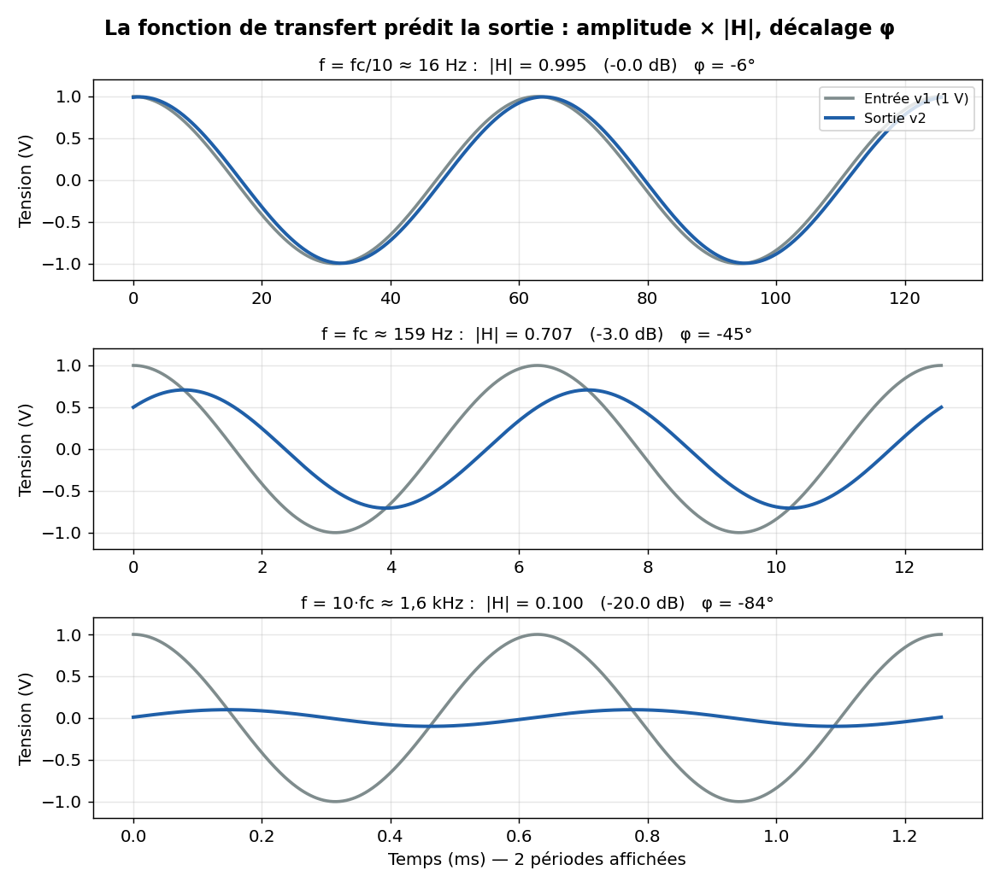
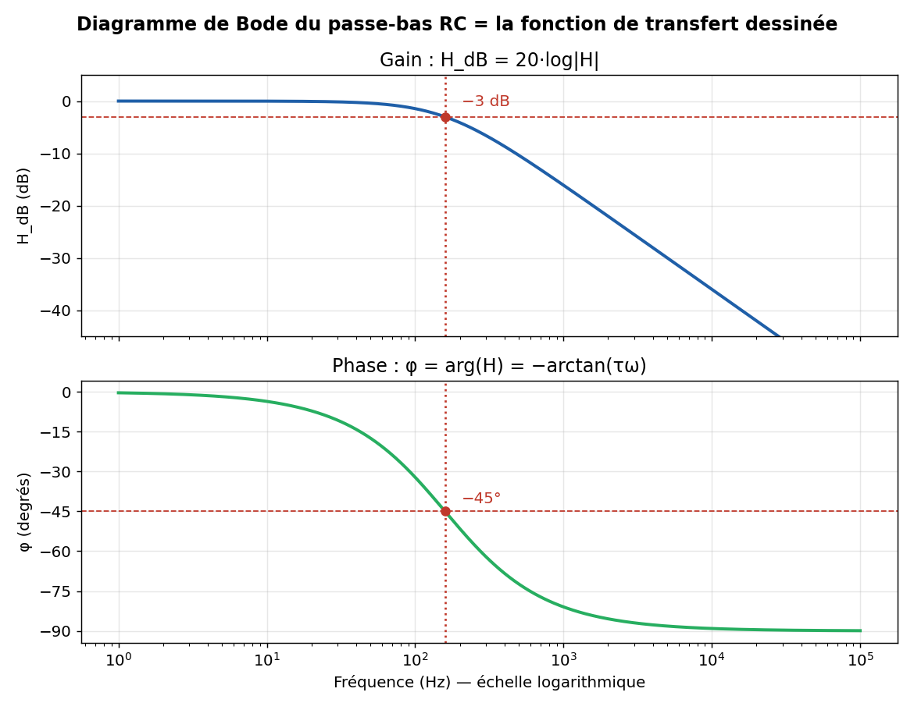

# Électronique — Gain en décibels, fréquence de coupure et fonction de transfert

---

## 1. Pourquoi une unité logarithmique ?

Le décibel ne mesure pas une grandeur, il mesure un **rapport** entre une sortie et une entrée (un **gain**).

Il utilise le logarithme décimal, qui « compte les multiplications par 10 » : log(10) = 1, log(100) = 2, log(1 000) = 3.

Trois avantages :

- **Écraser les grandes échelles** : un rapport de 1 à 1 000 000 devient une échelle de 0 à 60 dB.
- **Transformer les multiplications en additions** : pour des étages en cascade, les gains en dB s'additionnent.
- **Coller à la perception humaine** : l'oreille perçoit les rapports, pas les différences.

> **Propriétés du log utilisées dans ce chapitre**
> log(a × b) = log(a) + log(b)  
> log(1/a) = −log(a)  
> log(aⁿ) = n · log(a)  
> log(1) = 0

---

## 2. Rapport → dB

### Gain en puissance

Le décibel est défini sur des **puissances**. Le bel vaut log(P_out/P_in) ; le décibel est un dixième de bel, d'où le facteur 10 :

$$G_P(\text{dB}) = 10 \log\left(\frac{P_{out}}{P_{in}}\right)$$

### Gain en tension

$$G_V(\text{dB}) = 20 \log\left(\frac{V_{out}}{V_{in}}\right)$$

**D'où vient le 20 ?** La puissance dépend du **carré** de la tension (P = V²/R). Donc :

$$10\log\left(\frac{V_{out}}{V_{in}}\right)^2 = 2 \times 10\log\left(\frac{V_{out}}{V_{in}}\right) = 20\log\left(\frac{V_{out}}{V_{in}}\right)$$

20 = 10 (déci-bel) × 2 (carré de la tension). Le gain en **courant** suit la même règle (P = R·I²).

**Pourquoi c'est indispensable** : un même circuit doit avoir le **même gain en dB**, qu'on mesure les tensions ou les puissances. Une tension × 10 donne une puissance × 100 : 20·log(10) = 10·log(100) = 20 dB.

---

## 3. Valeurs remarquables (gain en tension)

| Tension | Gain |
|---|---|
| ÷ 2 | **−6 dB** |
| ÷ √2 | **−3 dB** |
| × 1 (inchangé) | **0 dB** |
| × √2 | **+3 dB** |
| × 2 | **+6 dB** |
| × 10 | **+20 dB** |

Valeurs exactes : 20·log(2) ≈ 6,02 dB et 20·log(√2) ≈ 3,01 dB, arrondies à 6 et 3.

Lecture du signe :

- **positif** = amplification
- **négatif** = atténuation
- **0 dB** = sortie égale à l'entrée (et non « rien du tout »)

### Les deux règles qui génèrent toute la table

> **Symétrie** : diviser donne la même valeur avec un signe moins (log(1/x) = −log(x)).  
> ×2 → +6 dB, donc ÷2 → −6 dB.

> **Addition** : multiplier les rapports revient à additionner les dB.  
> ×2 = ×√2 × √2, donc +3 + 3 = +6 dB.

Avec ×2 → +6 dB et ×10 → +20 dB, on reconstruit tout :

| Tension | Décomposition | Gain |
|---|---|---|
| × 4 | × 2 × 2 | 6 + 6 = **+12 dB** |
| × 8 | × 2 × 2 × 2 | **+18 dB** |
| × 20 | × 2 × 10 | 6 + 20 = **+26 dB** |
| × 100 | × 10 × 10 | **+40 dB** |
| ÷ 10 | symétrie | **−20 dB** |

### Tension ou puissance : ne pas confondre

| Rapport ×2 sur… | Gain |
|---|---|
| la **tension** | **+6 dB** |
| la **puissance** | **+3 dB** |

Une tension × √2 donne une puissance × 2 : c'est pour ça que +3 dB signifie aussi « puissance doublée ».

---

## 4. dB → rapport (passage inverse)

On « défait » le logarithme avec la puissance de 10, sa fonction réciproque (10^log(x) = x).

### Démonstration (cas de la tension)

1. On part de : G = 20 · log(V_out/V_in)
2. On divise par 20 : log(V_out/V_in) = G/20
3. On applique 10^(...) des deux côtés :

$$\frac{V_{out}}{V_{in}} = 10^{\,G_V(\text{dB})/20}$$

### Les deux formules

$$\frac{P_{out}}{P_{in}} = 10^{\,G_P(\text{dB})/10} \qquad\qquad \frac{V_{out}}{V_{in}} = 10^{\,G_V(\text{dB})/20}$$

On divise par le **même nombre** que celui qui multiplie le log : **10 pour les puissances**, **20 pour les tensions**.

> **Attention à l'écriture** : c'est 10 **puissance** (G/10), pas 10 × G/10.  
> À la calculatrice : `10^(G/20)`, avec les parenthèses autour de l'exposant.

### Exemples

| Gain | Calcul | Rapport |
|---|---|---|
| +14 dB (tension) | 10^(14/20) = 10^0,7 | **≈ 5** |
| −9 dB (tension) | 10^(−9/20) = 10^(−0,45) | **≈ 0,355** (soit ÷ 2,83) |
| −3 dB (tension) | 10^(−3/20) = 10^(−0,15) | **≈ 0,707** (soit ÷ √2) |
| +13 dB (puissance) | 10^(13/10) = 10^1,3 | **≈ 20** |
| +3 dB (puissance) | 10^(3/10) = 10^0,3 | **≈ 2** |

### Méthode de tête (sans calculatrice)

On décompose le gain en blocs connus, puis on **multiplie** les rapports correspondants.

- **+14 dB** (tension) = +20 − 6 → ×10 ÷ 2 = **×5**
- **−9 dB** (tension) = −6 − 3 → ÷2 ÷ √2 = **÷ 2√2 ≈ ÷ 2,83**
- **+26 dB** (tension) = +20 + 6 → ×10 × 2 = **×20**

> **Piège classique** : 14 dB ne veut pas dire « ×14 ».  
> En dB on **additionne**, en rapport on **multiplie**.

---

## 5. Récapitulatif

| | Puissance | Tension / courant |
|---|---|---|
| Rapport → dB | G = 10 · log(P_out/P_in) | G = 20 · log(V_out/V_in) |
| dB → rapport | P_out/P_in = 10^(G/10) | V_out/V_in = 10^(G/20) |
| ×2 | +3 dB | +6 dB |
| ×10 | +10 dB | +20 dB |
| ÷√2 en tension | — | −3 dB |

---

## 6. La fréquence de coupure

### Le problème

Dans le circuit RC du polycopié (sortie aux bornes du condensateur) :

- à **basse fréquence**, le condensateur se comporte comme un circuit ouvert → toute la tension arrive en sortie → le signal **passe** ;
- à **haute fréquence**, le condensateur se comporte comme un fil → la sortie tombe à 0 → le signal est **bloqué**.

C'est un **filtre passe-bas**. Mais le gain diminue **progressivement**, sans frontière nette. Il faut donc **choisir une convention** pour placer la frontière : c'est la fréquence de coupure.

### Définition

> **Fréquence de coupure f_c** (ou pulsation ω_c = 2πf_c) : fréquence où le gain vaut
> $$G(\omega_c) = \frac{G_{max}}{\sqrt{2}} \quad\Longleftrightarrow\quad G_{dB}(\omega_c) = G_{dB,max} - 3\text{ dB}$$

G est ici le gain **en rapport** (G = |V_s/V_e|), pas en dB.

**Bande passante** : ensemble des fréquences où G ≥ G_max/√2 (perte inférieure à 3 dB). Pour ce passe-bas : de 0 à f_c.

### Pourquoi √2 ? Le point de demi-puissance

La puissance dépend du **carré** de la tension (P = V²/R). Si la tension est divisée par √2, la puissance est divisée par (√2)² = **2**.

> La fréquence de coupure est le **point de demi-puissance** : la sortie ne reçoit plus que la moitié de sa puissance maximale.

### Pourquoi G_max et pas 1 ?

La frontière se mesure **par rapport au meilleur gain du circuit**. En RC passif, G_max = 1, donc G(ω_c) = 1/√2 ≈ 0,707. Un filtre actif peut avoir G_max = 10 : sa coupure est alors à 10/√2 ≈ 7,07 (voir section 7).

### Calcul pour le circuit RC

Gain du circuit (poly p. 44), avec τ = RC :

$$G(\omega) = \frac{1}{\sqrt{1 + \tau^2\omega^2}}$$

1. **G_max** : quand ω → 0, G → 1. Donc G_max = 1.
2. **Condition de coupure** : 1/√(1 + τ²ω_c²) = 1/√2
3. **Résolution** : 1 + τ²ω_c² = 2 → τ²ω_c² = 1 → τω_c = 1

$$\omega_c = \frac{1}{\tau} = \frac{1}{RC} \qquad\qquad f_c = \frac{1}{2\pi RC}$$

4. **Déphasage** : tan φ = −τω_c = −1 → **φ = −45°**

### Sens physique : R et C à égalité

À la fréquence de coupure :

$$|Z_C| = \frac{1}{C\omega_c} = \frac{1}{C \times \frac{1}{RC}} = R$$

> **À f_c, le condensateur a la même impédance que la résistance.**

- En dessous de f_c : |Z_C| > R → le condensateur récupère la plus grande partie de la tension → le signal passe.
- Au-dessus de f_c : |Z_C| < R → la résistance récupère la tension → le signal est coupé.

**Pourquoi 1/√2 et pas 1/2 alors que R = |Z_C| ?** Les tensions de R et de C sont **décalées de 90°**. Elles s'additionnent comme les côtés d'un triangle rectangle (Pythagore) : |R + Z_C| = √(R² + R²) = √2·R, et non 2R.

### Exemple chiffré

R = 1 kΩ, C = 1 µF → τ = 1 ms → ω_c = 1 000 rad/s → **f_c ≈ 159 Hz**

| Fréquence | G (rapport) | G (dB) | Interprétation |
|---|---|---|---|
| f_c/10 ≈ 16 Hz | ≈ 0,995 | ≈ 0 dB | passe presque intégralement |
| **f_c ≈ 159 Hz** | **0,707** | **−3 dB** | **frontière, demi-puissance** |
| 10·f_c ≈ 1,6 kHz | ≈ 0,1 | ≈ −20 dB | tension divisée par 10 |

Au-delà de f_c, le gain perd **20 dB par décade** (à chaque fois que la fréquence est multipliée par 10) : c'est la pente d'un filtre du **premier ordre**.

### Lien avec les valeurs remarquables

| Grandeur à ω_c | Valeur | Valeur remarquable correspondante |
|---|---|---|
| Gain (rapport) | 1/√2 ≈ 0,707 | même valeur que cos(45°) et que efficace/crête |
| Gain (dB) | −3 dB | tension ÷ √2 |
| Puissance | ÷ 2 | demi-puissance |
| Déphasage | −45° | tan φ = −1 |
| Condition | τω_c = 1 | \|Z_C\| = R |

---

## 7. Filtres passifs et filtres actifs

Même logique que la séance 1 : un dipôle **passif** ne génère pas d'énergie, un dipôle **actif** en génère.

### Filtre passif

- Composé **uniquement de R, L, C**, **sans alimentation**.
- Exemple : le circuit RC du polycopié.
- Ne peut **qu'atténuer** : G_max ≤ 1, soit G_dB,max ≤ 0 dB.
- **Défaut : l'effet de charge.** Une charge branchée en sortie se met en parallèle avec le condensateur et **modifie le gain et f_c**.

### Filtre actif

- Contient au moins un **composant actif alimenté** : le plus souvent un **amplificateur opérationnel (AOP)**.
- **Peut amplifier** : G_max > 1 possible (> 0 dB).
- **Supprime l'effet de charge** : l'AOP a une impédance d'entrée très grande et une impédance de sortie très faible.
- **Évite les bobines** (encombrantes, chères, imparfaites) : R et C suffisent.
- **Limites** : besoin d'une alimentation, sortie limitée par celle-ci (saturation), fréquence maximale limitée par l'AOP.

### Comparaison

| | Filtre passif | Filtre actif |
|---|---|---|
| Composants | R, L, C uniquement | R, C + AOP (ou transistor) |
| Alimentation | Non | Oui |
| Gain maximal | G_max ≤ 1 (≤ 0 dB) | G_max peut être > 1 (> 0 dB) |
| Effet de la charge | Modifie le gain et f_c | Quasi nul |
| Bobines nécessaires | Souvent | Non |
| Hautes fréquences / fortes puissances | Adapté | Limité |
| Simplicité et coût | Très simple, pas cher | Plus complexe |

> La définition **G(ω_c) = G_max/√2** marche pour les deux : on cherche toujours l'endroit où l'on perd **3 dB par rapport au gain maximal**.

---

## 8. La fonction de transfert

### Définition

> **Fonction de transfert** : rapport complexe entre la sortie et l'entrée d'un circuit en régime sinusoïdal.
> $$\underline{H}(j\omega) = \frac{\underline{V_2}}{\underline{V_1}} = \frac{\text{sortie}}{\text{entrée}}$$

Elle permet de savoir **comment le circuit transforme un signal sinusoïdal, pour chaque fréquence** : de combien il l'amplifie ou l'atténue (module), et de combien il le décale (argument). Elle permet aussi de tracer le **diagramme de Bode**.

### Module : le gain

$$H_{dB} = 20\log|\underline{H}| = 20\log\frac{|\underline{V_2}|}{|\underline{V_1}|}$$

| H_dB | Le système… |
|---|---|
| > 0 | amplifie |
| = 0 | ne modifie pas l'amplitude |
| < 0 | atténue |

### Argument : le déphasage

Si H = a + jb (a = partie réelle, b = partie imaginaire) :

$$\varphi(\omega) = \arg\big(\underline{H}(j\omega)\big) = \arctan\left(\frac{b}{a}\right) \quad \text{(valable si } a > 0\text{)}$$

| φ | La sortie est… |
|---|---|
| > 0 | en avance sur l'entrée |
| < 0 | en retard sur l'entrée |

> **Attention** : si a < 0, il faut ajouter ou retirer 180° (mauvais quadrant sinon).  
> **Pour une fraction**, plus simple : arg(N/D) = arg(N) − arg(D).

### À quoi elle sert

On calcule le circuit **une seule fois**, puis on obtient la sortie pour n'importe quel signal d'entrée sans tout refaire (même logique que Thévenin).

1. **Prédire la sortie** : si v₁(t) = V₁·cos(ωt), alors
$$v_2(t) = |\underline{H}(j\omega)| \cdot V_1 \cdot \cos\big(\omega t + \varphi(\omega)\big)$$
2. **Reconnaître le type de filtre** : regarder |H| quand ω → 0 et ω → ∞.
3. **Trouver la fréquence de coupure** : |H(ω_c)| = |H|_max/√2.
4. **Tracer le diagramme de Bode**.
5. **Enchaîner des circuits** (sans effet de charge) : H = H₁ × H₂ → les gains en dB **s'additionnent**, les phases aussi.

### Exemple : le RC du polycopié

Le poly trouve U = E/(1 + jωRC), donc :

$$\underline{H}(j\omega) = \frac{1}{1 + j\omega\tau} \qquad |\underline{H}| = \frac{1}{\sqrt{1+\tau^2\omega^2}} \qquad \varphi = -\arctan(\tau\omega)$$

Avec R = 1 kΩ, C = 1 µF (f_c ≈ 159 Hz) et une entrée de **1 V d'amplitude** :

| Fréquence | \|H\| | H_dB | φ | Sortie |
|---|---|---|---|---|
| 16 Hz | ≈ 0,995 | ≈ 0 dB | ≈ −6° | ≈ 1 V, quasiment pas décalée |
| 159 Hz | 0,707 | −3 dB | −45° | 0,707 V, en retard de 45° |
| 1,6 kHz | ≈ 0,1 | −20 dB | ≈ −84° | 0,1 V, presque en quadrature |

### Le diagramme de Bode

Le diagramme de Bode est **la fonction de transfert dessinée** : deux courbes en fonction de la fréquence (échelle logarithmique) :

- en haut, le **gain** H_dB ;
- en bas, la **phase** φ.

